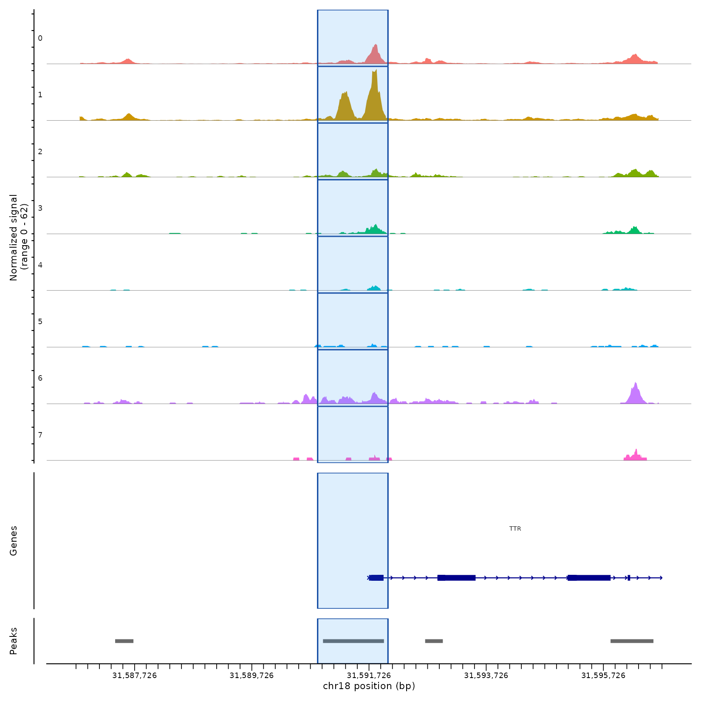

# VIGAT

**VIGAT** (<!-- TODO: full name, e.g. "VIsion-Guided ATAC ..." -->) uses a vision-capable large language model to read TSS-centered single-cell ATAC coverage plots and pick, for each marker gene, one compact genomic window that best captures its cluster-specific accessibility. VIGAT then counts fragments in those windows to build a gene-by-cell ATAC count matrix.

<!-- TODO: add a figure at man/figures/vigat_example.png, then uncomment:
<p align="center">
  
</p>
-->

## Installation

VIGAT needs R (>= 4.2). Install the Bioconductor and CRAN dependencies first, then install VIGAT from GitHub:

```r
install.packages(c("Seurat", "Signac", "remotes"))
if (!requireNamespace("BiocManager", quietly = TRUE)) install.packages("BiocManager")
BiocManager::install(c("GenomicRanges", "GenomeInfoDb", "IRanges", "S4Vectors", "BiocGenerics"))

remotes::install_github("beijie02/VIGAT")
```

## Quick start with a Signac object

```r
# IMPORTANT: never share your API key or commit it to GitHub
Sys.setenv(OPENAI_API_KEY = "your_openai_API_key")

library(VIGAT)
library(Seurat)
library(Signac)

# obj: a processed Signac Seurat object with an "ATAC" assay,
#      gene annotation, and fragment files.
# Set the active identity to your ATAC clustering.
Idents(obj) <- "ATAC_snn_res.0.8"

res <- run_vigat(
  obj     = obj,
  genes   = c("INS", "GCG", "SST", "PRSS1", "KRT19"),
  tissue  = "Islet",
  species = "human",
  outdir  = "VIGAT_output"
)

# Selected windows (one per gene)
res$vigat_window_df

# Gene-by-cell raw ATAC counts in the selected windows
res$count_matrix[, 1:5]

# Add as a new assay for downstream analysis
obj[["VIGAT"]] <- CreateAssayObject(counts = res$count_matrix)
```

## Output

`run_vigat()` returns a list and writes these files to `outdir`:

| Return value | File | Description |
|---|---|---|
| `vigat_windows` | `vigat_windows.rds` | `GRanges` of the selected window for each gene |
| `vigat_window_df` | `vigat_windows.csv` | The same windows as a data frame (gene, chr, start, end, width) |
| `count_matrix` | `vigat_count_matrix.rds` | Sparse gene-by-cell fragment counts in the windows |
| `diagnostics` | `raw_api_response.txt` | Raw model response, genes found and genes skipped |
| | `coverageplot_vigat_window_highlighted/` | Coverage plots with the selected window highlighted |

## Vignette

A full walkthrough on an example islet dataset: [VIGAT vignette](<!-- TODO: link to the rendered vignette HTML -->)

## Main arguments

| Argument | Default | Description |
|---|---|---|
| `obj` | | Signac Seurat object with an `ATAC` assay, annotation and fragments |
| `genes` | | Marker genes to score |
| `tissue` | | Tissue name passed to the model (improves accuracy) |
| `species` | `"human"` | Species passed to the model; `NULL` to omit |
| `cluster_col` | `NULL` | Metadata column with ATAC clusters; `NULL` uses `Idents(obj)` |
| `min_atac_cluster_cells` | `50` | Clusters smaller than this are dropped before plotting |
| `openai_model` | `"gpt-5.5"` | OpenAI model used to read the plots |
| `outdir` | `"VIGAT_output"` | Output directory |
| `save_intermediates` | `TRUE` | Save TSS info, peaks, prompt, coverage PDFs and API logs |
| `save_highlighted_plots` | `TRUE` | Save coverage plots with the selected window highlighted |

## Troubleshooting

- **`OPENAI_API_KEY is not set`**: set it with `Sys.setenv()` or add `OPENAI_API_KEY=...` to `~/.Renviron`.
- **Error in the count-matrix step**: `Fragments(obj)` must point to fragment files that exist on the machine running VIGAT.
- **Gene skipped**: the gene is missing from the ATAC annotation, or its chromosome is absent from the peak set. Check `res$diagnostics$genes_skipped`.
- **PDF too large**: OpenAI limits uploads to 50 MB. Use fewer genes per run.

## Citation

<!-- TODO -->

## Contact

<!-- TODO: authors and maintainer. -->
Please report bugs through [GitHub issues](https://github.com/beijie02/VIGAT/issues).
