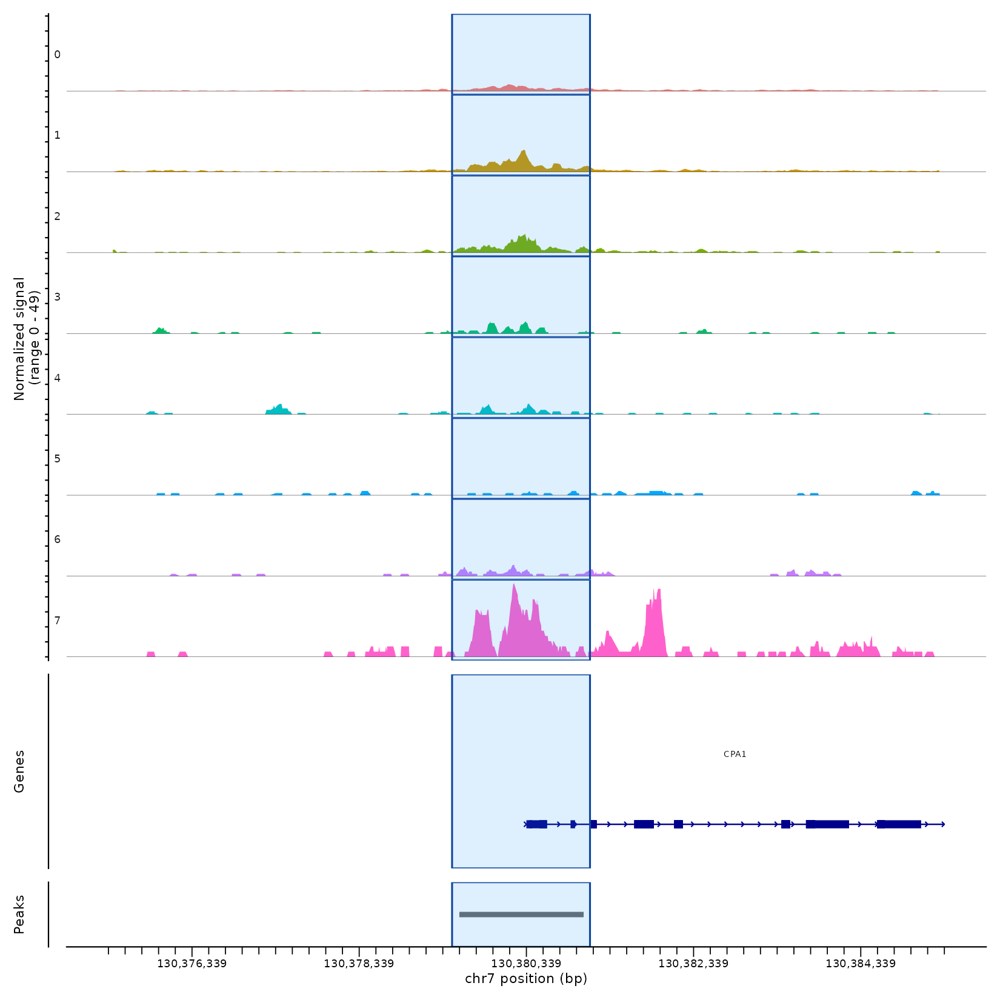
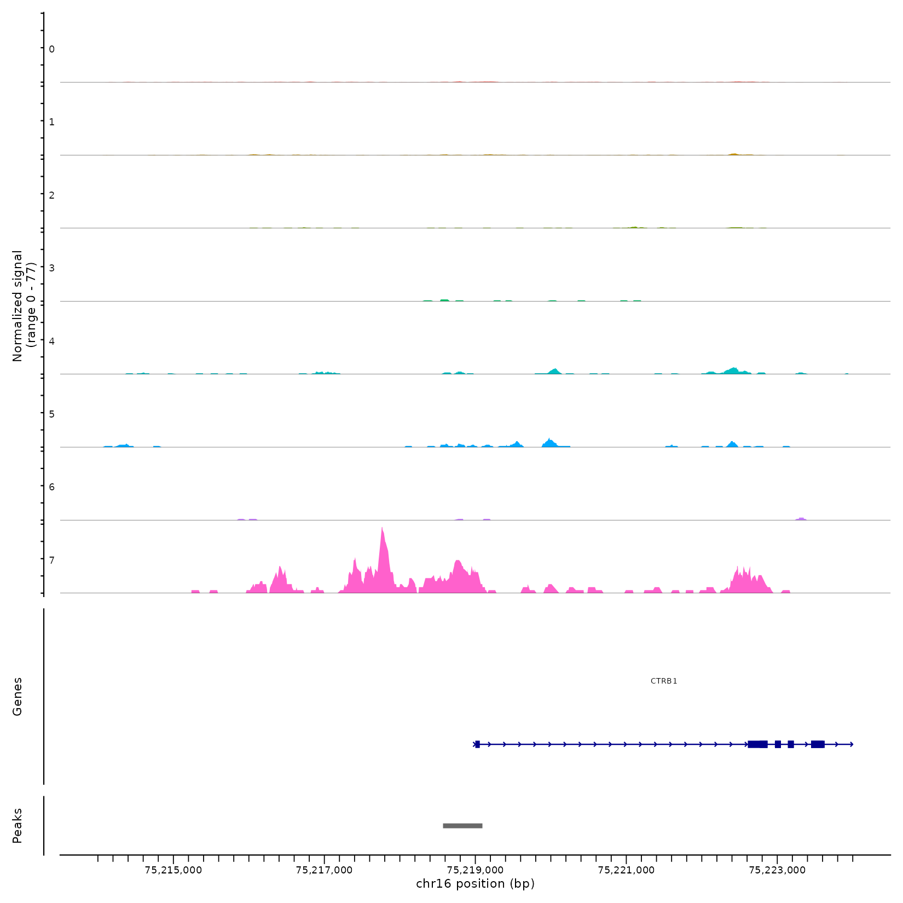
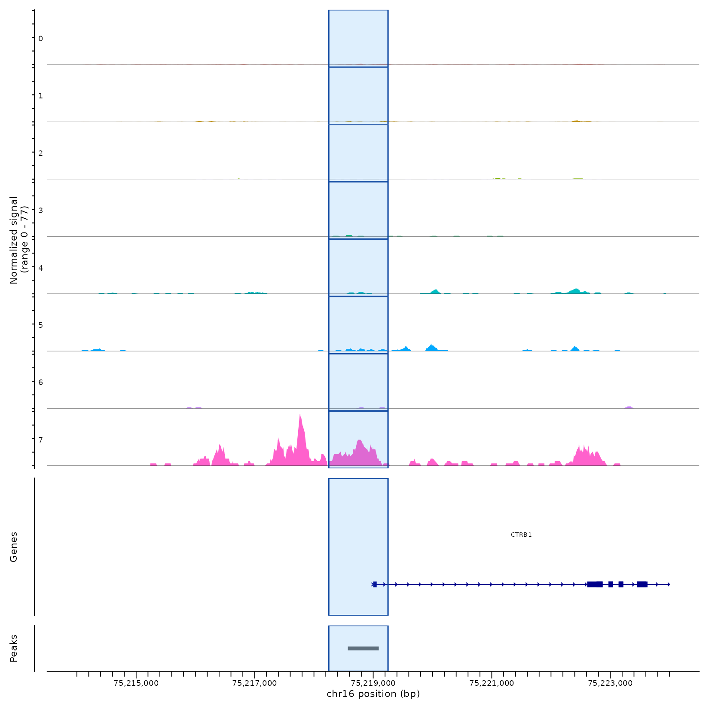
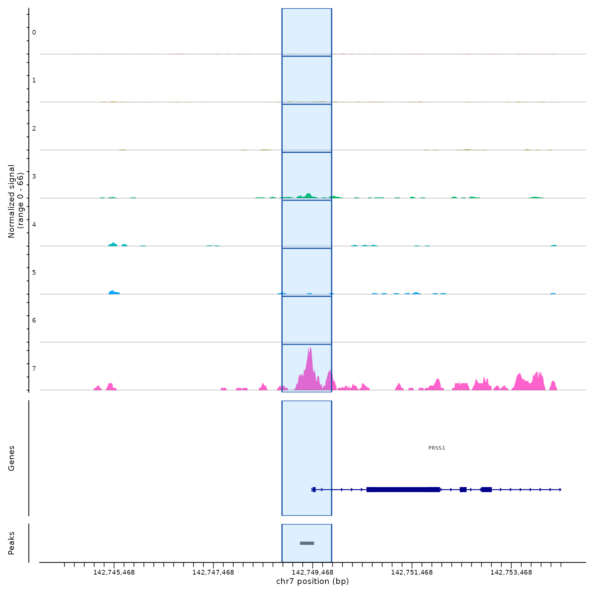
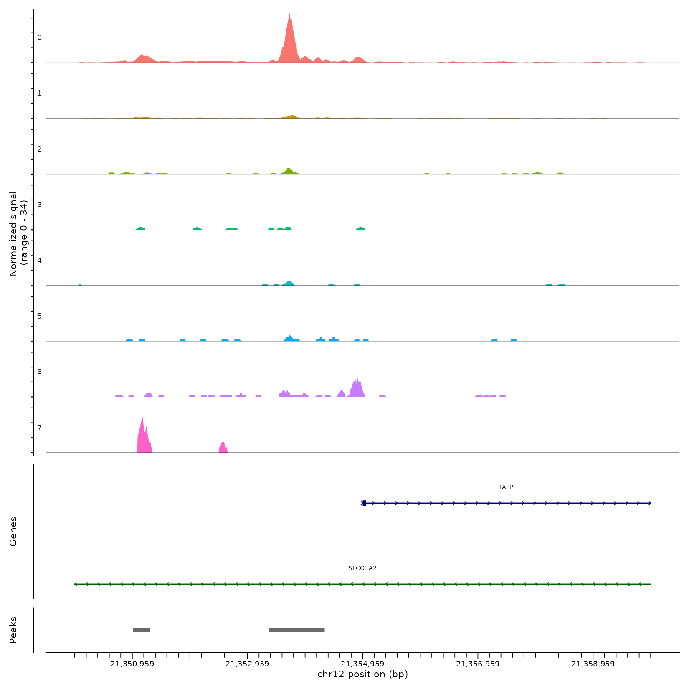
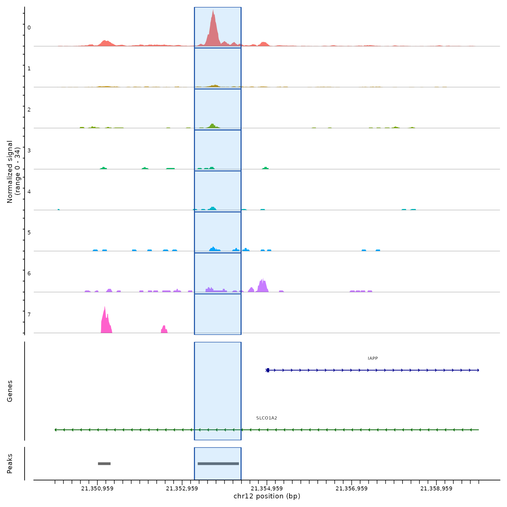
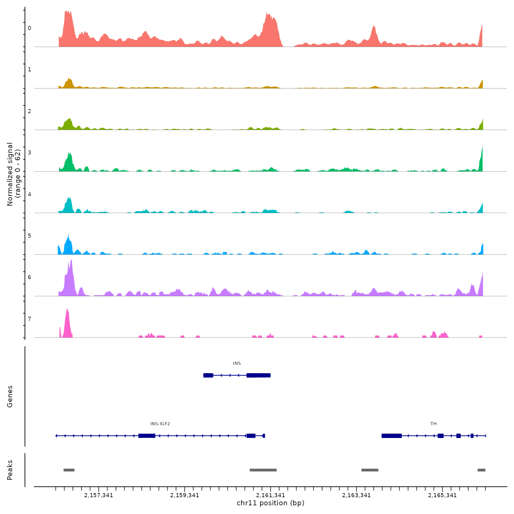
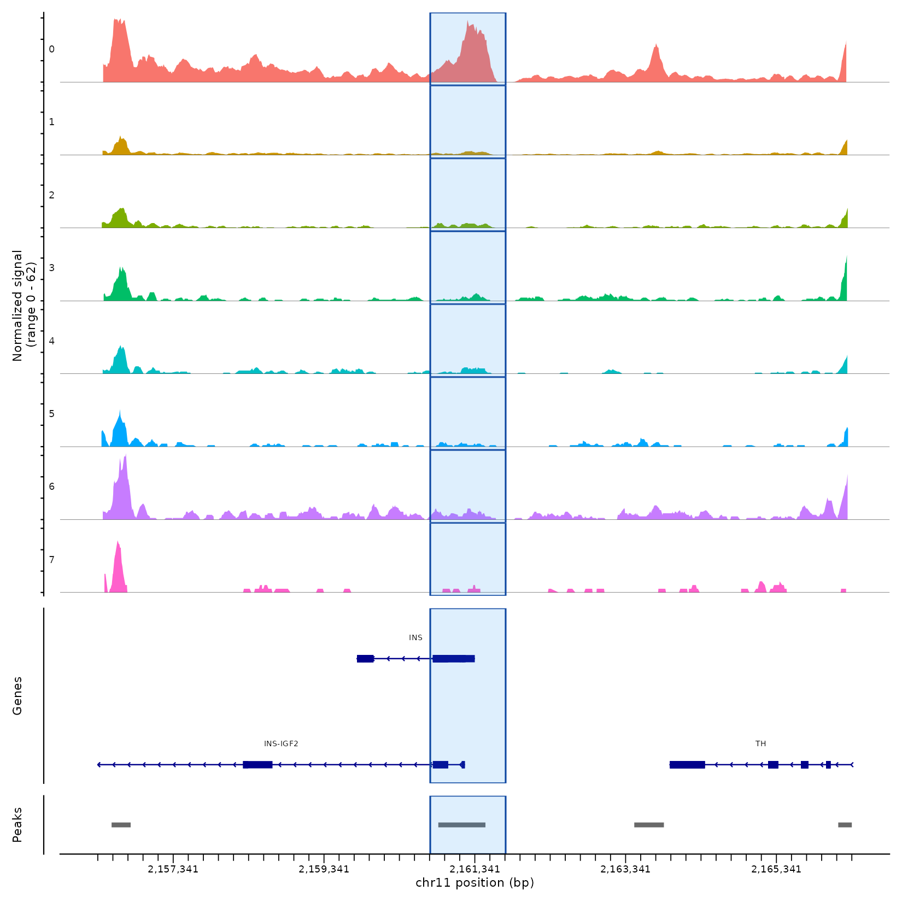
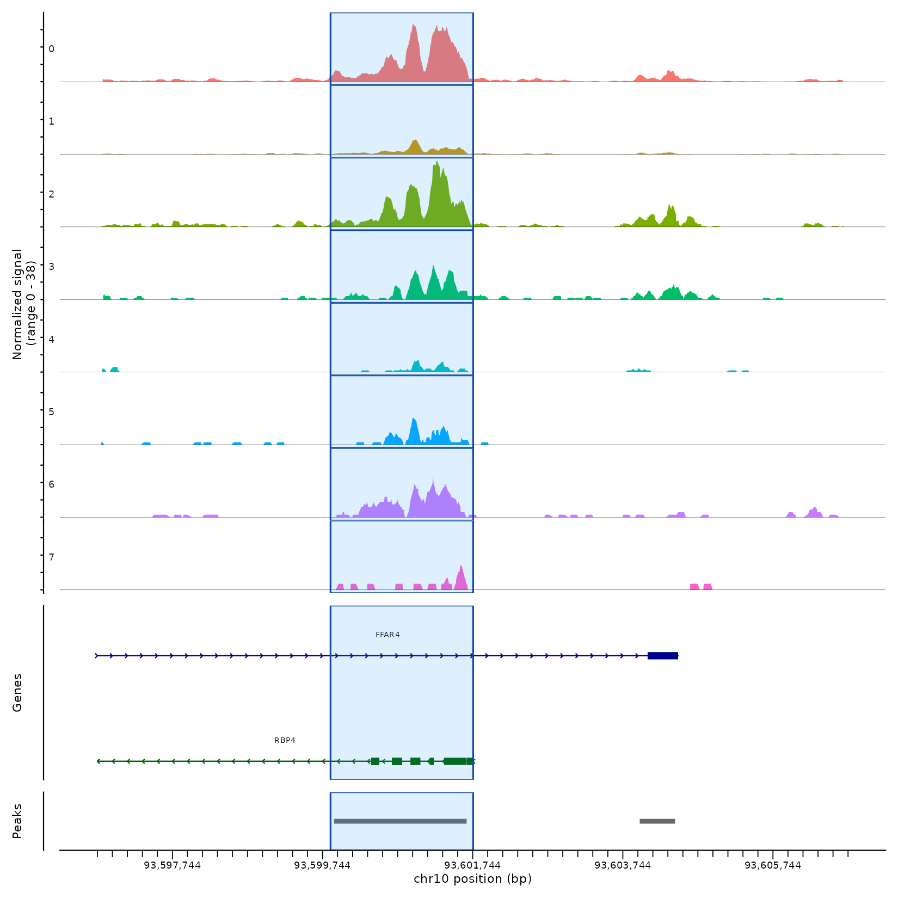
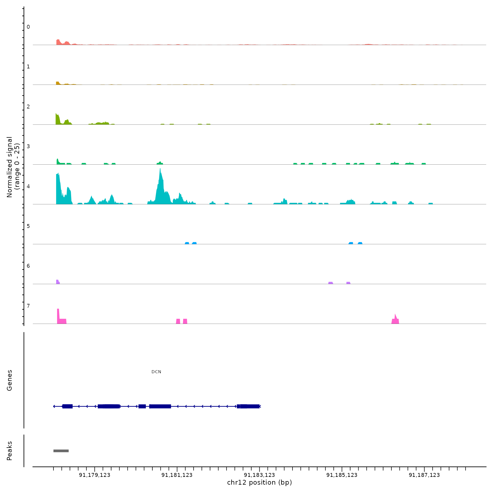

# Getting started with VIGAT

## Overview

Gene activity scores for single-cell ATAC-seq are usually computed by
counting fragments over a fixed region for every gene, such as the gene
body plus 2 kb upstream. A fixed rule can miss where the informative
accessibility actually is: the cell-type-specific signal may sit in a
short promoter peak, be offset from the annotated TSS, or be mixed with
signal from a neighbouring gene.

**VIGAT** (VLM-guided gene activity quantification) chooses the region
gene by gene, the way an analyst would by eye. For each marker gene it

1.  draws a coverage plot of the ±5 kb around the TSS, with one track
    per ATAC cluster, the gene model and the called peaks;
2.  sends the plots to a vision-language model (VLM) with instructions
    to pick one compact window that captures the clearest
    cluster-specific promoter signal;
3.  counts fragments in the selected windows to build a gene-by-cell
    matrix.

All of this happens in a single call to
[`VIGAT()`](https://beijie02.github.io/VIGAT/reference/VIGAT.md).

This vignette runs VIGAT on a human pancreatic islet sample with 15
marker genes for 7 cell types.

## Installation

``` r
install.packages(c("Seurat", "Signac", "remotes"))
if (!requireNamespace("BiocManager", quietly = TRUE)) install.packages("BiocManager")
BiocManager::install(c("GenomicRanges", "GenomeInfoDb", "IRanges",
                       "S4Vectors", "BiocGenerics"))
remotes::install_github("beijie02/VIGAT")
```

VIGAT reads your OpenAI API key from the `OPENAI_API_KEY` environment
variable. Add it once to `~/.Renviron`:

    OPENAI_API_KEY=your_openai_api_key

then restart R. Do not put the key in scripts or commit it to GitHub.

``` r
library(VIGAT)
library(Seurat)
library(Signac)
```

## Example data

The example is the human islet sample GSM7618328_GSM7618327 from
CompassDB. The object has been quality-controlled and clustered on the
ATAC data, and the cluster labels are stored in the metadata column
`ATAC_cluster`.

Three files are needed: the object `islet_example_atac.rds` (about 3.9
GB), the fragment file `islet_fragments.tsv.gz` (about 3 GB) and its
index `islet_fragments.tsv.gz.tbi`. Download them into the same folder:

``` r
options(timeout = 3600)   # large files: allow up to an hour per download
base <- "https://duke.box.com/shared/static"

download.file(file.path(base, "g31hskzlm8865ojydlyjtkurwz3ao4gc.rds"),
              "islet_example_atac.rds", mode = "wb")
download.file(file.path(base, "637jcsxkkw4dxn8oka7k6kig6uo5d905.gz"),
              "islet_fragments.tsv.gz", mode = "wb")
download.file(file.path(base, "7mzirxtynqummqoflwpquq2n9r28cda7.tbi"),
              "islet_fragments.tsv.gz.tbi", mode = "wb")
```

A Signac object stores the location of its fragment file, so point the
object to the downloaded file:

``` r
obj <- readRDS("islet_example_atac.rds")

frags <- Fragments(obj)
frags[[1]] <- UpdatePath(frags[[1]], new.path = "islet_fragments.tsv.gz")
Fragments(obj) <- NULL
Fragments(obj) <- frags

table(obj$ATAC_cluster)
```

The object has 10,093 cells in 8 ATAC clusters. To make the results
easier to read, the table below labels each cluster with the RNA cell
type that most of its cells belong to. VIGAT does not use these labels;
the model only sees the cluster numbers.

| ATAC cluster | Cells | Majority RNA cell type |
|:-------------|------:|:-----------------------|
| 0            | 5,796 | Beta cell              |
| 1            | 2,485 | Alpha cell             |
| 2            |   707 | Delta cell             |
| 3            |   276 | TUBA1A ductal cell     |
| 4            |   272 | Fibroblast             |
| 5            |   262 | Endothelial cell       |
| 6            |   221 | Alpha cell             |
| 7            |    74 | Acinar cell            |

## Marker genes

For each cell type present in the sample we use two or three marker
genes, taken from the cell type markers in
[DISCO](https://www.immunesinglecell.com/cell_type).

| Cell type          | Marker genes       |
|:-------------------|:-------------------|
| Acinar cell        | CPA1, CTRB1, PRSS1 |
| Alpha cell         | GCG, TTR           |
| Beta cell          | IAPP, INS          |
| Delta cell         | RBP4, SST          |
| Endothelial cell   | PECAM1, RAMP2      |
| Fibroblast         | DCN, LUM           |
| TUBA1A ductal cell | SERPINA1, SPP1     |

``` r
marker_genes <- c("CPA1", "CTRB1", "PRSS1",      # acinar
                  "GCG", "TTR",                 # alpha
                  "IAPP", "INS",                # beta
                  "RBP4", "SST",                # delta
                  "PECAM1", "RAMP2",            # endothelial
                  "DCN", "LUM",                 # fibroblast
                  "SERPINA1", "SPP1")           # ductal
```

## Run VIGAT

One call does the whole analysis:

``` r
res <- VIGAT(
  obj         = obj,
  genes       = marker_genes,
  tissue      = "Islet",
  species     = "human",
  cluster_col = "ATAC_cluster",
  return_highlighted_plots = TRUE
)
```

Inside [`VIGAT()`](https://beijie02.github.io/VIGAT/reference/VIGAT.md):

- Cells with no cluster label are removed, and so are clusters with
  fewer than `min_atac_cluster_cells` cells (50 by default). Here every
  cluster has at least 50 cells, so all 10,093 cells are kept.
- For each gene, the TSS and strand are taken from the gene annotation
  of the ATAC assay, and the called peaks within ±5 kb are collected.
- The coverage plots are laid out four genes per page and uploaded to
  the model as PDFs, together with a prompt that lists each gene, its
  strand and the overlapping peaks. The PDFs are written to a temporary
  folder and deleted when
  [`VIGAT()`](https://beijie02.github.io/VIGAT/reference/VIGAT.md)
  returns.
- The model returns one window per gene. VIGAT parses the windows and
  counts fragments in them with
  [`Signac::FeatureMatrix()`](https://stuartlab.org/signac/reference/FeatureMatrix.html).

[`VIGAT()`](https://beijie02.github.io/VIGAT/reference/VIGAT.md) writes
nothing to disk; everything comes back in `res`. The main outputs are
`res$vigat_windows`, the selected window for each gene, and
`res$count_matrix`, the gene-by-cell matrix of fragment counts in those
windows.

In this run the model (gpt-5.5) used 38,082 tokens and took about 2.1
minutes for 15 genes, sent as 4 PDF pages.

## Selected windows

`res$vigat_windows` is a `GRanges` object with one window per gene, and
`res$vigat_window_df` holds the same information as a data frame. The
model also explains each choice; its reply is kept in
`res$diagnostics$raw_response`. The table below combines the two.

| Gene | Strand | Window | Width (bp) | Anchor evidence | Strongest clusters | Model rationale |
|:---|:---|:---|---:|:---|:---|:---|
| CPA1 | \+ | chr7:130,379,450-130,381,100 | 1651 | called Peak chr7:130379537-130381024 | clusters 7, 1, 2, 3 | Promoter-side/TSS-proximal peak for the + strand gene, with clear acinar-like cluster-specific accessibility, especially cluster 7. |
| CTRB1 | \+ | chr16:75,218,250-75,219,250 | 1001 | called Peak chr16:75218572-75219094 | clusters 7, 5, 4 | Compact window around the promoter-overlapping called peak just upstream of the + strand TSS, avoiding more distal weak signal. |
| PRSS1 | \+ | chr7:142,748,850-142,749,850 | 1001 | called Peak chr7:142749214-142749495 | clusters 7, 3 | Sharp promoter-side accessibility overlapping the called peak near the + strand TSS. |
| GCG | − | chr2:162,152,004-162,153,004 | 1001 | called Peak overlapping the TSS (inside the window) | clusters 1, 6 | TSS-overlapping window at the - strand GCG promoter that captures the alpha-like signal in clusters 1 and 6, avoiding the strong upstream peak shared by most clusters. |
| TTR | \+ | chr18:31,590,850-31,592,050 | 1201 | called Peak chr18:31590941-31591981 | clusters 1, 0, 2, 3 | TSS-proximal/promoter peak with strong cluster-specific accessibility; avoids distal downstream/upstream peaks. |
| IAPP | \+ | chr12:21,353,250-21,354,350 | 1101 | called Peak chr12:21353327-21354299 | clusters 0, 6, 5, 2 | Promoter-side peak immediately upstream of the + strand IAPP TSS; avoids the more distal left peak likely less specific to IAPP. |
| INS | − | chr11:2,160,750-2,161,750 | 1001 | called Peak chr11:2160857-2161482 | cluster 0 | Promoter/TSS-proximal peak for the - strand INS locus, capturing the strongest useful promoter signal while avoiding distal TH-side peaks. |
| RBP4 | − | chr10:93,599,850-93,601,750 | 1901 | called Peak chr10:93599896-93601663 | clusters 0, 2, 3, 5, 6 | Broad but compact TSS-proximal/promoter-overlapping signal at the RBP4 end of the locus; avoids the more distal upstream peak. |
| SST | − | chr3:187,669,650-187,670,850 | 1201 | called Peak chr3:187669747-187670768 | clusters 2, 3, 4, 7 | Promoter-side peak overlapping the - strand SST TSS region, with strong cluster-specific signal. |
| PECAM1 | − | chr17:64,411,750-64,412,750 | 1001 | called Peak chr17:64411826-64412481 | cluster 5 | The canonical upstream/right-side peak is weak in the marker-like cluster, so this compact TSS-adjacent/proximal intragenic peak was selected because it gives the clearest PECAM1-specific signal. |
| RAMP2 | \+ | chr17:42,760,450-42,761,950 | 1501 | called Peak chr17:42760516-42761934 | cluster 5 | Selected the clearest proximal RAMP2-associated accessible region overlapping a called peak; the immediate upstream promoter-side signal is weak. |
| DCN | − | chr12:91,180,323-91,181,523 | 1201 | coverage-only | cluster 4 | No called peak overlaps the informative signal; compact intragenic window over the fibroblast-like coverage in cluster 4, avoiding the distal left-side signal shared across clusters. |
| LUM | − | chr12:91,110,950-91,111,950 | 1001 | called Peak chr12:91111385-91111750 | clusters 4, 6, 7 | Promoter/TSS-proximal peak for the - strand LUM gene, capturing the clearest local accessibility. |
| SERPINA1 | − | chr14:94,390,200-94,391,200 | 1001 | called Peak chr14:94390440-94391068 | clusters 3, 7, 2 | Promoter-side peak overlapping the - strand SERPINA1 TSS region; avoids the more downstream/internal peak. |
| SPP1 | \+ | chr4:87,974,650-87,975,850 | 1201 | called Peak chr4:87974783-87975774 | clusters 3, 7, 0, 2, 4 | TSS-proximal promoter-side peak for the + strand gene with strong, compact accessibility; avoids the more distal downstream gene-body peak. |

All 15 genes received a window between 1.0 and 1.9 kb. Fourteen are
anchored on a called peak; for DCN no peak overlaps the informative
signal, so the window follows the coverage alone.

The strongest clusters named by the model agree with the cell-type
labels above without the model having seen them: acinar genes (CPA1,
CTRB1, PRSS1) point to cluster 7, INS to cluster 0 (beta), PECAM1 and
RAMP2 to cluster 5 (endothelial), and DCN to cluster 4 (fibroblast).

## Coverage plots for every gene

Click a gene to see the plot the model received (top) and the window it
chose (bottom). To get these plots from your own run, set
`return_highlighted_plots = TRUE`; they are returned as
`res$highlighted_plots`, one ggplot per gene.

- CPA1
- CTRB1
- PRSS1
- GCG
- TTR
- IAPP
- INS
- RBP4
- SST
- PECAM1
- RAMP2
- DCN
- LUM
- SERPINA1
- SPP1

*Acinar cell marker.* Click a plot to open it at full size.

**Input to VIGAT** — the TSS ±5 kb coverage plot sent to the model

[](https://beijie02.github.io/VIGAT/articles/figures/islet_CPA1_before.png)

**VIGAT window** — the same plot with the selected window in blue

[](https://beijie02.github.io/VIGAT/articles/figures/islet_CPA1_vigat.png)

*Acinar cell marker.* Click a plot to open it at full size.

**Input to VIGAT** — the TSS ±5 kb coverage plot sent to the model

[](https://beijie02.github.io/VIGAT/articles/figures/islet_CTRB1_before.png)

**VIGAT window** — the same plot with the selected window in blue

[](https://beijie02.github.io/VIGAT/articles/figures/islet_CTRB1_vigat.png)

*Acinar cell marker.* Click a plot to open it at full size.

**Input to VIGAT** — the TSS ±5 kb coverage plot sent to the model

[](https://beijie02.github.io/VIGAT/articles/figures/islet_PRSS1_before.png)

**VIGAT window** — the same plot with the selected window in blue

[](https://beijie02.github.io/VIGAT/articles/figures/islet_PRSS1_vigat.png)

*Alpha cell marker.* Click a plot to open it at full size.

**Input to VIGAT** — the TSS ±5 kb coverage plot sent to the model

[](https://beijie02.github.io/VIGAT/articles/figures/islet_GCG_before.png)

**VIGAT window** — the same plot with the selected window in blue

[](https://beijie02.github.io/VIGAT/articles/figures/islet_GCG_vigat.png)

*Alpha cell marker.* Click a plot to open it at full size.

**Input to VIGAT** — the TSS ±5 kb coverage plot sent to the model

[](https://beijie02.github.io/VIGAT/articles/figures/islet_TTR_before.png)

**VIGAT window** — the same plot with the selected window in blue

[](https://beijie02.github.io/VIGAT/articles/figures/islet_TTR_vigat.png)

*Beta cell marker.* Click a plot to open it at full size.

**Input to VIGAT** — the TSS ±5 kb coverage plot sent to the model

[](https://beijie02.github.io/VIGAT/articles/figures/islet_IAPP_before.png)

**VIGAT window** — the same plot with the selected window in blue

[](https://beijie02.github.io/VIGAT/articles/figures/islet_IAPP_vigat.png)

*Beta cell marker.* Click a plot to open it at full size.

**Input to VIGAT** — the TSS ±5 kb coverage plot sent to the model

[](https://beijie02.github.io/VIGAT/articles/figures/islet_INS_before.png)

**VIGAT window** — the same plot with the selected window in blue

[](https://beijie02.github.io/VIGAT/articles/figures/islet_INS_vigat.png)

*Delta cell marker.* Click a plot to open it at full size.

**Input to VIGAT** — the TSS ±5 kb coverage plot sent to the model

[](https://beijie02.github.io/VIGAT/articles/figures/islet_RBP4_before.png)

**VIGAT window** — the same plot with the selected window in blue

[](https://beijie02.github.io/VIGAT/articles/figures/islet_RBP4_vigat.png)

*Delta cell marker.* Click a plot to open it at full size.

**Input to VIGAT** — the TSS ±5 kb coverage plot sent to the model

[](https://beijie02.github.io/VIGAT/articles/figures/islet_SST_before.png)

**VIGAT window** — the same plot with the selected window in blue

[](https://beijie02.github.io/VIGAT/articles/figures/islet_SST_vigat.png)

*Endothelial cell marker.* Click a plot to open it at full size.

**Input to VIGAT** — the TSS ±5 kb coverage plot sent to the model

[](https://beijie02.github.io/VIGAT/articles/figures/islet_PECAM1_before.png)

**VIGAT window** — the same plot with the selected window in blue

[](https://beijie02.github.io/VIGAT/articles/figures/islet_PECAM1_vigat.png)

*Endothelial cell marker.* Click a plot to open it at full size.

**Input to VIGAT** — the TSS ±5 kb coverage plot sent to the model

[](https://beijie02.github.io/VIGAT/articles/figures/islet_RAMP2_before.png)

**VIGAT window** — the same plot with the selected window in blue

[](https://beijie02.github.io/VIGAT/articles/figures/islet_RAMP2_vigat.png)

*Fibroblast marker.* Click a plot to open it at full size.

**Input to VIGAT** — the TSS ±5 kb coverage plot sent to the model

[](https://beijie02.github.io/VIGAT/articles/figures/islet_DCN_before.png)

**VIGAT window** — the same plot with the selected window in blue

[](https://beijie02.github.io/VIGAT/articles/figures/islet_DCN_vigat.png)

*Fibroblast marker.* Click a plot to open it at full size.

**Input to VIGAT** — the TSS ±5 kb coverage plot sent to the model

[](https://beijie02.github.io/VIGAT/articles/figures/islet_LUM_before.png)

**VIGAT window** — the same plot with the selected window in blue

[](https://beijie02.github.io/VIGAT/articles/figures/islet_LUM_vigat.png)

*TUBA1A ductal cell marker.* Click a plot to open it at full size.

**Input to VIGAT** — the TSS ±5 kb coverage plot sent to the model

[](https://beijie02.github.io/VIGAT/articles/figures/islet_SERPINA1_before.png)

**VIGAT window** — the same plot with the selected window in blue

[](https://beijie02.github.io/VIGAT/articles/figures/islet_SERPINA1_vigat.png)

*TUBA1A ductal cell marker.* Click a plot to open it at full size.

**Input to VIGAT** — the TSS ±5 kb coverage plot sent to the model

[](https://beijie02.github.io/VIGAT/articles/figures/islet_SPP1_before.png)

**VIGAT window** — the same plot with the selected window in blue

[](https://beijie02.github.io/VIGAT/articles/figures/islet_SPP1_vigat.png)

## Save the results

Because [`VIGAT()`](https://beijie02.github.io/VIGAT/reference/VIGAT.md)
does not write files, save what you need yourself:

``` r
saveRDS(res, "vigat_islet_result.rds")
write.csv(res$vigat_window_df, "vigat_windows.csv", row.names = FALSE)

for (g in names(res$highlighted_plots)) {
  ggplot2::ggsave(paste0(g, "_vigat.png"), res$highlighted_plots[[g]],
                  width = 11, height = 11, dpi = 150)
}
```

Model replies can differ slightly between runs, so keep the saved result
(including `res$vigat_windows`) for the analysis you report.

## Inspect intermediate results

Set `return_intermediates = TRUE` to also get the inputs VIGAT built for
the model:

``` r
res <- VIGAT(obj, genes = marker_genes, tissue = "Islet",
             cluster_col = "ATAC_cluster", return_intermediates = TRUE)

res$intermediates$tss_info           # TSS, strand and plotted region per gene
res$intermediates$overlapping_peaks  # called peaks inside each region
res$intermediates$coverage_plots     # the plots sent to the model
cat(res$intermediates$prompt)        # the full prompt
res$intermediates$api_run_info       # model, tokens, time
```

## Options

| Argument | Default | Description |
|----|----|----|
| `obj` | (required) | Signac Seurat object with an `ATAC` assay, gene annotation and fragment files |
| `genes` | (required) | Marker genes to score |
| `tissue` | (required) | Tissue name given to the model as context, e.g. `"Islet"` |
| `species` | `"human"` | Species given to the model; `NULL` omits it |
| `cluster_col` | `NULL` | Metadata column with ATAC clusters; `NULL` uses `Idents(obj)` |
| `min_atac_cluster_cells` | `50` | Clusters with fewer cells are removed before plotting |
| `openai_model` | `"gpt-5.5"` | OpenAI model that reads the plots |
| `return_intermediates` | `FALSE` | Also return TSS info, peaks, input coverage plots, prompt and API logs |
| `return_highlighted_plots` | `FALSE` | Also return one coverage plot per gene with the selected window highlighted |

## Session info

``` r
sessionInfo()
```

    #> R version 4.5.1 (2025-06-13)
    #> Platform: aarch64-apple-darwin20
    #> Running under: macOS Tahoe 26.5
    #> 
    #> Matrix products: default
    #> BLAS:   /Library/Frameworks/R.framework/Versions/4.5-arm64/Resources/lib/libRblas.0.dylib 
    #> LAPACK: /Library/Frameworks/R.framework/Versions/4.5-arm64/Resources/lib/libRlapack.dylib;  LAPACK version 3.12.1
    #> 
    #> locale:
    #> [1] en_US.UTF-8/en_US.UTF-8/en_US.UTF-8/C/en_US.UTF-8/en_US.UTF-8
    #> 
    #> time zone: America/New_York
    #> tzcode source: internal
    #> 
    #> attached base packages:
    #> [1] stats     graphics  grDevices utils     datasets  methods   base     
    #> 
    #> loaded via a namespace (and not attached):
    #>  [1] digest_0.6.37     desc_1.4.3        R6_2.6.1          fastmap_1.2.0    
    #>  [5] xfun_0.56         cachem_1.1.0      knitr_1.50        htmltools_0.5.8.1
    #>  [9] rmarkdown_2.29    lifecycle_1.0.5   cli_3.6.5         sass_0.4.10      
    #> [13] pkgdown_2.2.1     textshaping_1.0.3 jquerylib_0.1.4   systemfonts_1.2.3
    #> [17] compiler_4.5.1    rstudioapi_0.17.1 tools_4.5.1       ragg_1.5.0       
    #> [21] bslib_0.9.0       evaluate_1.0.5    yaml_2.3.10       jsonlite_2.0.0   
    #> [25] rlang_1.1.7       fs_1.6.6          htmlwidgets_1.6.4
